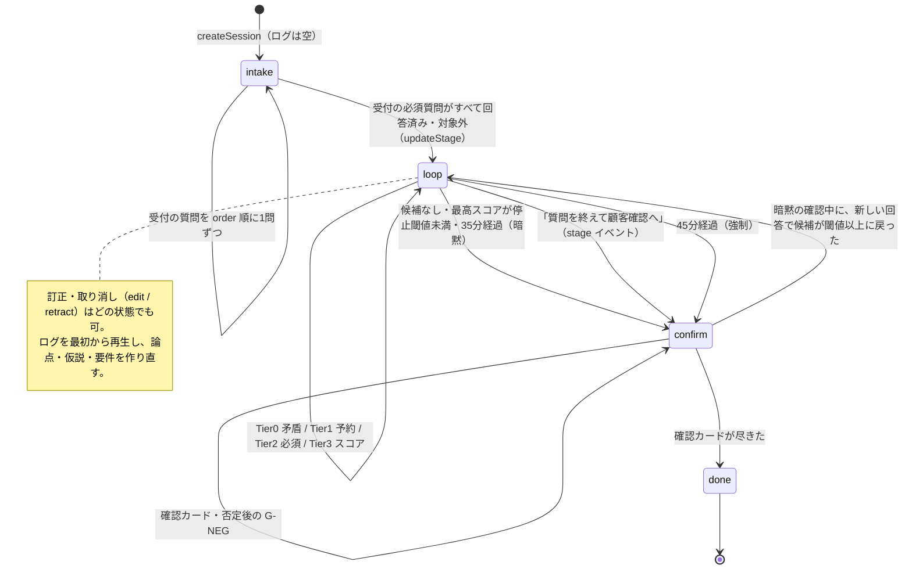
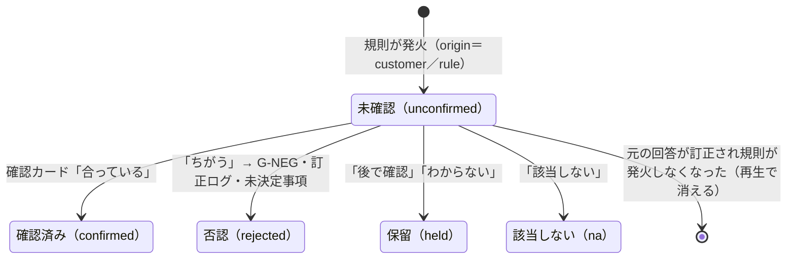
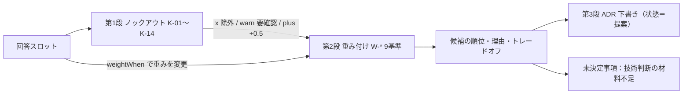
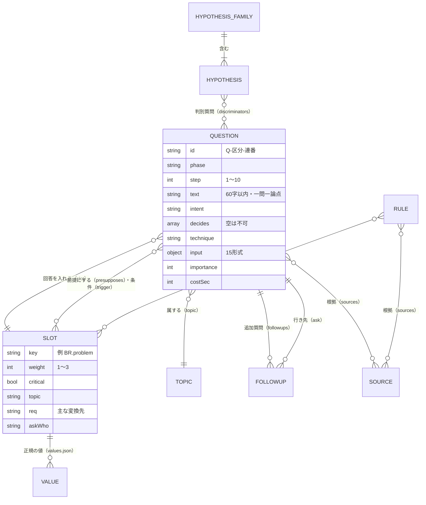
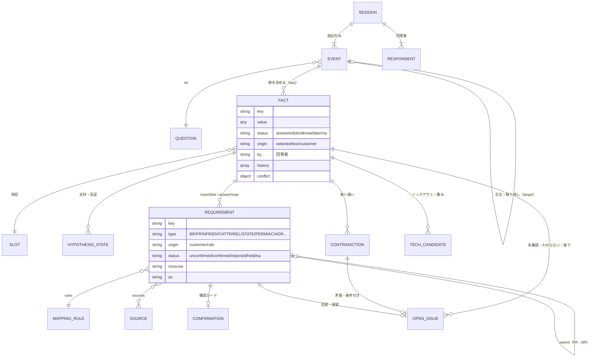

# 01 設計書 — AIなし要件ヒアリングツール

- 作成日：2026-11-13
- 対象：`src/engine/*.js`、`src/ui/app.js`、`data/*.json`、`tools/*.js` の 2026-11-13 作業中スナップショット（質問151問＝汎用9を含む、要件変換規則72本、分岐11、矛盾11、仮説群2、ノックアウト14）
- 書き方：実装にあることだけを書く。設計にあって実装にないものは【未実装】。本書の解釈は【推測】。
- 根拠資料と採用理由は `docs/00_資料分析.md`（以下「00」）。

## §0 要点

1. 聞き取り中にAIを使わない。質問DB・条件式・ルール・状態管理だけで動く。
2. 記録は「追記のみの回答ログ」。状態は毎回ログを先頭から再生して作る。同じログ＋同じルール版なら同じ状態・同じ次の質問になる。
3. 次の一問は、Tier 0〜3 の順位とスコアで決める。重み・閾値はすべて初期パラメータで、実測値ではない。
4. 推定した要件は必ず「未確認」で作る。「確認済み」に変えられるのは顧客確認カードだけ。
5. 推奨構成は、端末内で完結する静的な1ページ（ローカルファイル／GitHub Pages／Artifacts で開く）＋記録の正本としてのスプレッドシート。

---

## §1 全体像

### 1.1 構成

| 層 | ファイル | 役割 |
|---|---|---|
| データ | `data/questions/*.json` | 質問DB（書き方は `docs/QUESTION_SCHEMA.md`） |
| | `data/slots.json`、`data/values.json` | 回答を入れる項目と、正規の値 |
| | `data/rules/*.json` | 論点・仮説・矛盾・分岐・深掘り・要件変換・技術選定・語彙・エンティティ |
| | `data/params.json` | 重み・閾値・時間（初期パラメータ）と `ruleVersion` |
| ビルド | `tools/build.js` | 全JSONを1つのDBにまとめ、検査し、`src/generated/db.js` を書き出す。エラーがあれば終了コード1 |
| エンジン | `cond.js` 条件式／`detect.js` 自由記述の形式判定／`engine.js` 再生と回答の適用／`derive.js` 論点・仮説・矛盾・分岐・要件／`select.js` 次の一問と残り時間／`tech.js` 技術選定／`quality.js` 未決定事項・品質・判定／`report.js` 要件定義書とTSV | すべて純関数か、ログを入力とする決定論的な処理 |
| 画面 | `index.html`、`src/ui/app.js` | 1問1画面のスワイプ式カードと FDE 画面。外部通信なし |
| 検証 | `tools/simulate.js`、`tools/scenarios.js` | 仮想回答者で最後まで自動実行し、質問数・推定時間・判定を出す（時間は `costSec` による推定） |

### 1.2 状態遷移



【事実】`state.stage` が `confirm` になるのは stage イベント（`goConfirm`）があるときだけ。暗黙の確認段階は `select.next` が `stage: 'confirm'` を返すだけで、`state.stage` は `loop` のまま。そのため新しい回答で質問に戻りうる。`updateStage` は `state.stopLoop` も見るが、それを立てる処理はない。

### 1.3 イベント（保存するのはこれだけ）

| type | 内容 | 再生時の扱い |
|---|---|---|
| `answer` | `iid`、`kind`（value／dontknow／later／na）、`value`、`raw`、`epistemic`、`ms`、`note` | 回答を適用し、導出物を再計算 |
| `edit` | `target`（元の seq）と新しい値 | 元の回答を無効にし、訂正ログに前後の値を残す |
| `retract` | `target` | 元の回答を無効にし、訂正ログに残す |
| `respondent` | 回答者ID | 以後の回答の回答者・立場を切り替える |
| `stage` | `to: 'confirm'` | 顧客確認へ |
| `note` | メモ | 保持のみ |

セッションの形式は `fde-hearing-session/1`。`meta` に `dbVersion` と `ruleVersion` を持つ。

---

## §2 10ステップ

【事実】`engine.js` 冒頭：S1〜S4＝`intake`、S5〜S9＝`loop`、S10＝`confirm`。質問の `step` 属性は1〜10。

### S1 相談内容の理解

| 項目 | 内容 |
|---|---|
| 入力 | `Q-INT-001`（相談の原文、longtext）、`Q-INT-002`（新規／改修）、`Q-INT-003`（使う人）、`Q-INT-004`（作りたいものの種類、複数）、`Q-INT-008`（決める人） |
| 処理・判定 | 受付は `order` の固定順（`select.next` の intake 分岐）。原文は `detect.analyzeText` で形式判定。`solutionOnly` なら原文を `BR.means` にも写す（`copyTo`） |
| 出力 | `PRJ.request_raw`、`PRJ.kind`、`PRJ.audience`、`PRJ.category`、`PRJ.decision_maker` |
| 遷移 | 受付の全質問が回答済み、または `trigger` 不成立・立場が対象外なら `loop`（`updateStage`） |
| エラー時 | 「わからない／後で確認／該当しない」は値なしで記録。重み3以上の項目が「わからない」なら `G-WHOKNOWS` を予約 |
| 関連 | `engine.applyAnswer`、`detect.analyzeText`、`select.next` |

### S2 事実・推測の分類

| 項目 | 内容 |
|---|---|
| 入力 | `Q-INT-005`（困りごとの種類、複数）、`Q-INT-006`（いちばん困っていること、longtext）、`EPI` |
| 処理・判定 | `epistemic: true` の質問に答えると `EPI@<slot>` を予約し、本人が「事実（見た・数えた）／伝聞／推測／希望／混在」を選ぶ。`detect` の `epistemicHint` は画面の初期の並び順にだけ使い、分類を確定しない |
| 出力 | `<slot>__epi`。品質指標 Q2 |
| 遷移 | S1 と同じ |
| エラー時 | 分類しなかった自由記述は Q2 の分母に残る |
| 関連 | `engine.applyAnswer`（EPI 予約）、`quality.metrics` |

### S3 論点候補の抽出

| 項目 | 内容 |
|---|---|
| 入力 | `Q-INT-007`（論点カードを当てはまる／ちがう／わからないに仕分け）と、S1 の回答 |
| 処理・判定 | `derive.computeTopics`：`always`、`forceWhen`、`activateWhen`（規則）、カードの「当てはまる」のどれかで有効。「ちがう」は規則で有効になっていなければ無効。分岐フラグで有効になる論点を反映するため2回計算する |
| 出力 | `state.topics`（論点ごとの有効・理由） |
| 遷移 | — |
| エラー時 | 論点が無効なら、その論点の質問は出ない。`ISS.topics` は再生のたびに再評価される |
| 関連 | `data/rules/topics.json`（17論点）、`derive.computeTopics` |

### S4 競合仮説の設定

| 項目 | 内容 |
|---|---|
| 入力 | `Q-HYP-001`（原因カード、`optionsFrom: hyp:HF-CAUSE`）と関連スロット |
| 処理・判定 | `derive.computeHypotheses`：群の `activateWhen` が偽なら `inactive`。`refuteWhen` が真なら `refuted`、`supportWhen` が真なら `supported`、どちらでもなければ `alive`。群は「生存2以上かつ支持0」で `open`（未決着） |
| 出力 | `state.hyps`、`state.families` |
| 遷移 | — |
| エラー時 | 反証条件のない仮説は `build.js` がエラーにする |
| 関連 | `data/rules/hypotheses.json`（HF-CAUSE 7仮説、HF-SOLUTION 4仮説） |

### S5 判断に重要な質問の選択

| 項目 | 内容 |
|---|---|
| 入力 | 現在の状態（スロット、論点、仮説、矛盾、分岐、予約、経過時間） |
| 処理・判定 | `select.next`：Tier 0 矛盾 → Tier 1 予約 → Tier 2 必須 → Tier 3 スコア順（§3） |
| 出力 | `{stage, iid, tier, score, parts, why}`。`why` は意図と加点理由の説明文 |
| 遷移 | 候補なし・閾値未満・時間切れで確認へ |
| エラー時 | 解決できない予約（DBにない iid）は候補から外す |
| 関連 | `select.candidates`、`select.explain` |

### S6 平易な一問への変換

| 項目 | 内容 |
|---|---|
| 入力 | 質問DBの1行、`iid`（`質問ID@パラメータ`） |
| 処理・判定 | `engine.resolveQuestion`：`{{スロット}}` を回答の値で置換（値がなければ「それ」）。汎用深掘りは対象項目名 `paramLabel` と直前の回答 `prev` を入れる。選択肢を辞書から作る（`optionsFrom`：topics／entities／hyp:<群>／slot:<項目>）。執筆時の検査は `build.js`：疑問符1つ、並列語・専門用語の禁止、70字超で注意、`decides`・`sources` 必須、値は `values.json` のものだけ |
| 出力 | 表示用の質問オブジェクト（`text`、`help`、`input`、`slot`） |
| 遷移 | — |
| エラー時 | ビルドで検査に落ちた質問は書き出されない（終了コード1）。前提項目（`presupposes`）が未回答なら出題しない |
| 関連 | `engine.resolveQuestion`、`engine.optionsFrom`、`util.template`、`tools/build.js` |

### S7 回答の分析

| 項目 | 内容 |
|---|---|
| 入力 | 回答イベント |
| 処理・判定 | `applyAnswer`：形式ごとに値を正規化（数値、カードは yes を本体・no/unknown を別スロット、配分は最多を `__top`、手順は空行を除く）。選択肢の `set`・`flags`・`ask` を適用。前の回答者と構造化値が食い違えば `conflict` を残す（テキスト項目は対象外）。`recompute` で論点・分岐・仮説・矛盾・要件・技術候補を作り直す |
| 出力 | `state.slots`（値・状態・出どころ・回答者・履歴）、`state.contradictions`、`state.corrections` |
| 遷移 | 矛盾が開いたら次は Tier 0 |
| エラー時 | 質問がDBにない（版違い）→ `orphans`「質問がDBにない」。訂正で前提が変わり出題条件を満たさない → `orphans`「前提が変わった」。どちらも未決定事項「前提変更」になる |
| 関連 | `engine.applyAnswer`、`engine.setSlot`、`engine.recompute`、`derive.computeContradictions` |

### S8 追加質問

| 項目 | 内容 |
|---|---|
| 入力 | 直前の回答と形式判定 |
| 処理・判定 | 予約の順：①質問の `followups`（`when` が真）、②深掘り規則（`deepdive.json`。質問の `deepdive` に書かれた判定だけ、最初の1つだけ）、③ `EPI`。汎用深掘りの深さを項目ごとに数え、`maxDepth`（2）以上なら `deep` の追加質問を出さない。確認で「ちがう」→ `G-NEG`。重要項目の「わからない」→ `G-WHOKNOWS` |
| 出力 | `state.queue`（`iid`、理由、元の seq、深さ） |
| 遷移 | 次は Tier 1（新しい予約から） |
| エラー時 | 既に聞いた・既に予約済みの iid は重複させない。予約先の項目が解決済みなら出さない |
| 関連 | `engine.enqueue`、`data/rules/deepdive.json`、`data/questions/90_generic.json` |

### S9 要件情報への構造化

| 項目 | 内容 |
|---|---|
| 入力 | スロット、仮説の状態 |
| 処理・判定 | `derive.computeRequirements`（§5）。`tech.evaluate`（§6） |
| 出力 | `state.reqs`（種別・本文・顧客向けの文・出どころ・規則・根拠回答・親・優先・受け入れ条件・状態）、`state.tech` |
| 遷移 | — |
| エラー時 | テンプレートの値がなければ「（未定）」と出す |
| 関連 | `data/rules/mappings.json`（72本）、`data/rules/tech.json` |

### S10 顧客確認

| 項目 | 内容 |
|---|---|
| 入力 | `confirm: true` かつ顧客向けの文があり、未確認の要件 |
| 処理・判定 | `select.confirmCandidates`：種別の順（`params.confirm.typeOrder`：VIS→BR→CON→FR→NFR→PERM→ENT→ATTR→RULE→BP→INT→MIG→AC→ADR）、同順位は要件キーの辞書順。最大14枚。カードは「合っている／ちがう」＋メモ |
| 出力 | `state.confirmations`。合っている＝`confirmed`、ちがう＝`rejected`、後で・わからない＝`held`、該当しない＝`na` |
| 遷移 | 「ちがう」→ `G-NEG@<要件>` を予約し、確認中でも先に出す。カードが尽きたら `done` |
| エラー時 | 「ちがう」は訂正ログ（`confirm-reject`）と未決定事項「否認」（Must なら実装を止める）に入る |
| 関連 | `engine.confirmQuestion`、`select.confirmCandidates`、`quality.readiness` |

---

## §3 動的な質問選択

### 3.1 Tier

| Tier | 対象 | 並べ方 |
|---|---|---|
| 0 | 開いている矛盾（`C-*`、回答者間の `C-RESP@<項目>`） | 重大度の高い順、同じなら ID 順 |
| 1 | 予約された追加質問 | 新しい予約から（話の流れを切らない）、同じなら iid 順 |
| 2 | 必須確認：分岐で必須になった論点の重要度3以上の質問、`mandatory: true`、条件付き `mandatory` が真 | スコアに1000を足して上位に |
| 3 | それ以外 | スコア順 |

受付（intake）中は、受付の質問だけを `order` 順に出す。確認段階では Tier 0 は出さず、Tier 1 と確認カードだけを出す。

### 3.2 候補から外す条件

立場が対象外／論点が無効／同じ `dedupe` グループを既に聞いた／既に聞いた iid／`trigger` が偽／`skipIf` が真／`presupposes` の項目が未回答／回答先の項目が解決済み（回答・わからない・後で確認・該当しない・確認済み）／時間圧迫中で必須でなく重要度4未満。

### 3.3 スコア

```
score = 1.0·U + 0.8·D + 1.5·I + 0.4·F + 0.6·B + 1.2·O − 0.6·C·(時間圧迫なら2、それ以外1)
```

| 項 | 定義（`select.candidates`） | 意味 |
|---|---|---|
| U | 回答先の項目の `weight`（1〜3）。項目がなければ0.5 | 不確実性の代理。【推測】回答の分布から計算した不確実性ではなく、項目の重要さの静的な重み |
| D | `decides` の件数×0.5 ＋ 未決着の仮説群でこの質問を判別質問に持つ生存仮説の数×1 ＋ 技術選定の必須入力が未回答なら1 | 答えで判断が変わる度合い |
| I | `importance`／5 | 要件定義上の重要度 |
| F | log2(1＋この項目を条件に使う規則の数)。数えるのは質問の `trigger`、要件変換の `when`、ノックアウトの `when`、矛盾の `when`（DB読み込み時に1回だけ） | 後続への影響 |
| B | 分岐規則がこの論点に足した加点の合計（`boost`） | 分岐フラグによる優先 |
| O | 1 − フェーズの位置／フェーズ数（18） | 会話の自然な順への小さな寄与 |
| C | `costSec`／60。省略時は形式ごとの既定（yesno 8秒、single 15、multi 25、text 45、longtext 90、cards 60、steps 120 など） | 回答負荷 |

### 3.4 時間・停止・見積もり

| 項目 | 値（`params.json`） | 動作 |
|---|---|---|
| 目標時間 | `targetMin` 35分 | 超えたら Tier 2（必須）だけを出す（ソフト停止） |
| 上限 | `hardMaxMin` 45分 | 超えたら確認段階へ強制 |
| 時間圧迫 | 残り `pressureMin` 8分未満 | 必須でない重要度4未満を外し、C 項を2倍 |
| 停止閾値 | `stopScore` 1.6 | 最高スコアが下回り必須がなければ確認段階へ |
| 経過時間 | 回答ごとに `min(ms/1000, maxCardSec 300)` を加算 | 放置した画面で時間が膨らまないように |
| 深掘りの深さ | `maxDepth` 2 | 三手目は出さない |

残りの見積もり（`select.estimate`）：

```
質問の秒 = (必須の候補の costSec 合計 ＋ 閾値以上の任意候補の costSec 合計) × (1＋想定追加率 0.25) ＋ 予約数 × 30
確認の秒 = min(14, 確認対象の未確認要件数) × 8
残り分   = ceil((min(質問の秒, 残り予算) ＋ 確認の秒) / 60)
進み具合 = 有効な論点の重要項目のうち解決済みの割合
```

【事実】`tools/simulate.js` の6シナリオでは、質問92〜107問、確認14枚、推定28.9〜37.4分（2026-11-13 実行、`costSec` による推定で実測ではない）。

### 3.5 決定論の保証

| 仕組み | 実装 |
|---|---|
| 乱数・時刻を判定に使わない | 時刻は `ts`・案件IDの既定値にだけ使う。経過時間は回答の `ms` から作る |
| 安定ソート | `util.stableSortBy`：スコア降順、同点はキー（iid・要件キー・候補ID）の辞書順、最後に元の順 |
| 同じログ→同じ状態 | `engine.replay` が毎回ログを先頭から再生する |
| ルール版 | `params.ruleVersion`（現在 `2026.11.13-1`）をセッションの `meta` と TSV の各行に記録。DB版は `ruleVersion＋質問数` |
| 版違いの検出 | DBにない質問への回答は `orphans` に落とす。`meta.ruleVersion` と現在の版が違うファイルを開くと、画面で警告する（`app.js` の `open`）。エンジン側での版ごとの再生は【未実装】 |

**重み・閾値・既定秒・時間はすべて初期パラメータで、実証済みの値ではない**（`params.json` の `_doc` も同じ）。変えたら `ruleVersion` を上げる（§9）。

---

## §4 依頼の9分岐

依頼文の9分岐の原文は本書作成時に参照していない。下表は実装の規則を9つに整理したもの【推測】。検出の可否は「AIなしで機械的に判定できるか」。

| # | 条件 | 動作 | 実装の規則ID | 検出 |
|---|---|---|---|---|
| 1 | 回答が抽象的 | いちばん最近の一件を聞く→まだ抽象的なら時点に狭める | `deepdive.json` abstract→`G-CONCRETE`→`G-TIME` | 可（字数15未満、抽象語・ぼかし語があり数字・日付・観察語がない）。意味の抽象度は不可 |
| 2 | 解決策が先に出る | 誰のどんな困りごとが減るかを聞く→条件に狭める。困りごとの論点を必須に | solutionOnly→`G-PROBLEM`→`G-COND`、`B-SOLUTION` | 可（手段語あり・困りごと語なし）。言い換えの判定は不可 |
| 3 | 根拠がない・推測 | 根拠の種類を聞く→伝聞・感覚なら確かめられる人を聞く | needsEvidence／speculative→`G-EVIDENCE`→`G-WHO`、`B-EVIDENCE` | 可（評価語あり・数字なし、推量語あり） |
| 4 | 成果の測り方が不明 | 成果の論点を必須に | `B-KPI`、矛盾 `C-10` | 可（構造化項目） |
| 5 | 仕事の流れが未整理 | 流れの論点を必須に | `B-FLOW` | 可（`ASIS.steps` 未解決）。手順の抜けの意味は不可 |
| 6 | データが不明 | 情報の種類ごとに件数・見分け方・状態を繰り返し聞く | `B-DATA`、`forEach: DAT.things` の質問 | 可（カードで選んだ種類が対象）。自由記述からの名詞抽出は不可 |
| 7 | 権限が未定義 | 見える範囲・変更者の論点を必須に | `B-ROLE`、矛盾 `C-02` | 可 |
| 8 | 回答が矛盾 | 2つの回答を並べて確かめる（対置型） | `C-01`〜`C-11`（Tier 0）、`C-RESP@<項目>` | 構造化項目どうしは可。自由記述どうしは不可 |
| 9 | 技術選定の材料不足 | 規模・機密・ログイン・公開・予算・体制を必須に、D 項に加点 | `B-TECH`、`B-TECH2`、`tech.missingInputs` | 可 |

ほかの分岐：「わからない」→`G-WHOKNOWS`／個人情報あり→`B-PII`／一般の個人向け→`B-TOC`／完成の基準が未定義→`B-ACCEPT`／確認で否定→`G-NEG`。

---

## §5 要件変換

### 5.1 規則の形

`data/rules/mappings.json` の1行：`{id, when, forEach?, emit:[{type, key, title, text?, plain?, origin?, confirm?, moscow?, topic?, parent?, ac?, trace?}], sources}`。

| 処理（`derive.computeRequirements`） | 内容 |
|---|---|
| 発火 | `when` が真。`forEach` があれば、その項目の値（例：扱う情報の種類）ごとに展開 |
| 同じキー | 複数の規則が同じ要件を導いたら、規則IDを追加するだけ |
| 根拠 | `traceSlots`（`trace` または `when` の参照項目）と `answerSeqs`（その項目を決めた回答の seq） |
| 出どころ | `origin: customer`＝回答をそのまま要件にした／`rule`＝規則による推定（既定） |
| 親 | 指定の親（事業要求）がなければ `BR-GOAL`、なければ `BR-01` につなぐ |
| 優先 | 規則に `moscow` がなければ、`PRI.must`（大事な順に並べたもの）で上位3論点に属する FR・NFR・INT を Must、それ以外の並べた論点を Should、並べていない論点を Could とする。`moscowBy` に「推定」と記録 |
| 状態 | 必ず `unconfirmed` で作る。`state.confirmations` だけが変えられる |

### 5.2 スロット → 要件種別

| 種別 | 規則数 | 主な元の項目 | 例 |
|---|---|---|---|
| VIS 事業の思い | 1 | `VIS.mission` ほか | `M-VIS-01` |
| BR 事業要求 | 4 | `BR.problem`、`BR.goal_type`、`BR.kpi_metric`、`BR.roi_hours` | `M-BR-01`（BR-01）、`M-BR-02`（BR-GOAL） |
| CON 制約 | 8 | `PRJ.deadline`、`CON.budget_monthly`・`maintainer`・`workspace`、`PRJ.conformance_docs`、`OUT.words_rule`、`VIS.not_do`、`AC.feedback_style` | `M-CON-01`、`M-VIS-02` |
| FR 機能要件 | 19 | `OUT.outputs`、`ROLE.login`、`RULE.approval`、`DAT.carry_over`、`TOC.*`、`AI.want` | `M-FR-PDF`、`M-FR-AI`（AI作業ごと） |
| NFR 非機能 | 11 | `NFR.*`、`DAT.pii`、`OUT.devices` | `M-PII`（Must） |
| ENT／ATTR／REL／STATE データ | 1／2／8／2 | `DAT.things`（種類ごと）、`DAT.{e}.attrs`・`status`、`REL.*` | `M-ENT`、`M-ATTR`、`M-REL-customer_order` |
| ROLE／PERM 立場・見える範囲 | 2／5 | `ROLE.list`、`ROLE.matrix`（立場ごと）、`ROLE.see_scope`、`ROLE.edit_scope` | `M-PERM-見る`、`M-PERM-ROW` |
| BP／RULE 業務 | 2／3 | `ASIS.steps`、`TOBE.change`、`RULE.*` | `M-BP-01`、`M-BP-02` |
| INT／MIG 連携・移行 | 1／1 | `INT.systems`（サービスごと）、`MIG.existing_data` | `M-INT`、`M-MIG` |
| AC 受け入れ条件 | 3 | `AC.done_definition`、`BR.success_check` ほか | `M-AC-01`、`M-BR-05` |
| ADR 決定 | 2 | 仮説の支持（作らない案）、`OUT.publish` | `M-ADR-00`、`M-ADR-PUB` |
| CR 変更要求 | 1 | `CR.kind`（種類ごと） | `M-CR` |

### 5.3 状態の遷移



【事実】`origin: customer` の要件も `unconfirmed` から始まる。回答そのままでも、要件の文に言い換えた時点で確認の対象になる。

---

## §6 事業要件と技術選定の接続



| 段 | 実装（`tech.evaluate`） | 事業要件とのつながり |
|---|---|---|
| 必須入力 | `requiredInputs` 10項目：利用者数、同時利用、機密性、ログイン、見える範囲、運営が入力を見るか、月の予算、保守者、契約中のサービス、公開方法 | 未回答は D 項に+1、未決定事項（実装を止める）、R05 |
| ノックアウト | 条件が真なら候補ごとに `x`（除外）／`warn`（要確認）／`plus`（+0.5） | 例：個人情報×外部送信不可×AI→端末内・AI上のツールを除外（K-09）、月0円・カード不可→サーバー＋RDB と既製品を除外（K-07） |
| 重み付け | 基準ごとに重み（既定1〜3、`weightWhen` で1〜5）×点（1〜5、未定義は3）。点＝Σ(重み×点)/Σ重み＋加点 | 予算0円→費用の重み5、1か月以内→立ち上げの重み5、見える範囲を分ける→権限の重み4、一般の個人向け→画面の自由度の重み4 |
| 順位 | 候補（+100）＞要確認（+50）＞除外、同点は候補ID順 | 必須入力が全部あれば `confident` |
| ADR | `report.js` が上位候補・トレードオフを「ADR 下書き（ステータス：提案）」として出す。要件 `M-ADR-00`（設定変更・ルール変更・既製品の仮説が支持された）、`M-ADR-PUB`（公開方法） | 採択はしない。FDE と顧客が決める |

8類型：A スプレッドシート＋フォーム／B ＋Apps Script／C AppSheet／D 端末内で完結する静的Webページ／E AIアシスタント上のツール／F Webアプリ＋BaaS／G Webアプリ＋サーバー＋RDB／H 既製サービス。上限・料金は zip の確認値（2026-11-13）で、本ツールでは再確認していない（`tech.json` の `_doc`）。点数は初期設計値。

---

## §7 データモデル

### 7.1 質問DB



`RULE` は分岐 `B-*`・矛盾 `C-*`・要件変換 `M-*`・ノックアウト `K-*`・深掘り・論点の総称。

### 7.2 要件DB（セッションから導出）

保存するのはセッション（メタ＋イベント）だけ。下の DERIVED はすべて再生で毎回作る。



| 依頼の用語 | 本ツールでの実体 |
|---|---|
| 質問 | `QUESTION` |
| 回答 | `EVENT`（answer/edit） |
| 根拠資料 | `SOURCE`（`data/sources.json` の A/B/C/D/zip/STD） |
| 事実 | `FACT`（スロットの値。本人の分類は `<項目>__epi`） |
| 仮説 | `HYPOTHESIS_STATE` |
| 決定 | 要件種別 `ADR`、矛盾への回答（`contraAnswered`）。決定ログの独立した表は【未実装】 |
| 未決定事項 | `OPEN_ISSUE`（`quality.openIssues`、毎回導出。ID は OI-001 からの連番） |
| 機能要件 | `REQUIREMENT`（type＝FR） |
| データ要件 | `REQUIREMENT`（type＝ENT/ATTR/REL/STATE） |
| 受け入れ条件 | `REQUIREMENT.ac`（要件ごと）と type＝AC の要件 |

出力：`report.markdown`（要件定義書。1 訂正・否定した点を先頭に、推定と確認済みを分けて書く）と `report.sheets`（requirements／openIssues／answers の3つのTSV。各行に案件ID、answers にはルール版と秒）。

---

## §8 品質指標と仕様確定の判定

### 8.1 品質指標（`quality.metrics`）

品質は質問の多さではなく、曖昧さの解消・事実と仮説の区別・トレーサビリティで測る。

| ID | 定義 |
|---|---|
| Q1 曖昧さの解消 | 有効な論点の重要項目のうち、回答（確認済み含む）がある割合 |
| Q2 事実と仮説の区別 | `epistemic` の質問への回答のうち、本人が分類（`__epi`）を済ませた割合 |
| Q3 仮説の検証可能性 | 有効な仮説群のうち、全仮説に反証条件があり、判別質問を1つ以上聞いた割合 |
| Q4 目的と機能のつながり | 機能要件のうち、親の事業要求がある割合（逆向きの件数も表示） |
| Q5 データ・権限・例外 | エンティティ要件で件数・見分け方が解決済みのもの＋権限・例外の3項目のうち解決済みの割合 |
| Q6 未決定事項の登録 | 未解決の重要項目がすべて未決定事項にあれば1、なければ0 |
| Q7 顧客確認 | 確認したカードのうち「合っている」の割合 |
| Q8 効率 | 解決済みの重要項目数／質問数。DBの質問数と、出さなかった数も表示 |

### 8.2 仕様確定の判定（`quality.readiness`）

| ID | 内容 | 種類 |
|---|---|---|
| R01 | Must の FR・NFR がすべて顧客確認済み | 必須 |
| R02 | 実装を止める未決定事項が0件 | 必須 |
| R03 | 事業要求（BR）がすべて顧客確認済み | 必須 |
| R04 | エンティティごとに件数と見分け方の回答がある | 条件 |
| R05 | 技術判断の必須入力がそろっている | 条件 |
| R06 | 個人情報があれば、保存期間・閲覧者・外部送信可否が回答済み | 必須 |
| R07 | 構造化項目の矛盾が未確認で残っていない | 条件 |
| R08 | 重要項目に未確認・わからない・後で確認が残っていない | 条件 |
| R09 | 人間レビュー待ちの自由記述を FDE が確認した | 条件（手動） |

判定：必須が1つでも不合格＝「未確定」／条件だけ不合格＝「条件付き」／全合格＝「仕様確定」。

実装上の注意【事実】：

| 点 | 影響 |
|---|---|
| R09 は FDE 画面「人間レビュー」で「確認した」を押すと記録される（`engine.markReviewed`、イベント `fdeReview`） | 自由記述の確認を終えるまで「仕様確定」にならない |
| R01・R03 は対象が0件だと合格する | Must や BR が1つも導かれていないと素通りする。R02（重要項目の未決）で止まる想定【推測】 |
| R04 は項目の存在だけを見る（「わからない」も合格） | Q5 は解決状態で数えるので基準がずれる |
| R06 は利用目的を見ない（zip R06 は4点） | 利用目的は質問・判定に含まれていない |
| 確認カードは最大14枚 | 確認対象が14を超えると R01・R03 が残りうる。追加の確認は次回の聞き取りか FDE 画面で行う想定【推測】 |

---

## §9 計測と改善

### 9.1 記録されるもの

| データ | 場所 |
|---|---|
| 回答ごとの秒（画面表示から回答まで） | `EVENT.ms`（`app.js` が `Date.now()` の差で記録）。経過時間には1枚300秒を上限に加算 |
| 特別な回答 | `EVENT.kind`（dontknow／later／na） |
| 深掘りの発生 | `state.queue` の予約（元の seq・深さ・理由） |
| 訂正・否定 | `state.corrections`（edit／retract／confirm-reject／訂正語） |
| 版 | `meta.ruleVersion`、TSV answers の「ルール版」列 |

### 9.2 集計と調整の手順

集計ツールは `tools/analyze-logs.js`（`npm run analyze -- <回答ファイルのフォルダ>`）。質問ごとに回答数・所要秒の中央値と推定値の差・特殊回答率・訂正率・深掘り率を出す。

| 指標（質問ごと） | 計算 | 調整先 |
|---|---|---|
| 回答秒の中央値 | 同じ質問IDの `ms` の中央値（外れ値に強いため中央値） | `costSec` を置き換える |
| 「わからない」「後で確認」の率 | kind の割合 | 高い質問は、立場の制限（`persona`）・`askWho`・言い回しを見直す。重要度を下げるかは FDE が判断 |
| 「該当しない」の率 | 同上 | `trigger`・`skipIf` を見直す |
| 深掘りになった率 | その質問の回答から予約が出た割合 | 高いなら選択肢化・例の追加 |
| 否認の率（要件変換規則ごと） | 確認カードの「ちがう」の割合 | `mappings.json` の条件・文面 |
| 出なかった率 | 候補になったが選ばれなかった割合 | 重み（`weights`）と `stopScore` |

手順：①回答JSONを集める → ②集計 → ③ `params.json`・質問の `costSec` を変更 → ④ `tools/simulate.js` で6シナリオの質問数・推定時間・判定を比較 → ⑤ `ruleVersion` を上げる → ⑥ `node tools/build.js --check`。古いセッションは旧版の DB で再生しないと `orphans` が出る。

---

## §10 実行基盤の比較

### 10.1 比較

出典のない仕様は書かない。zip の出典（確認日 2026-11-13、本セッション未再確認）は【zip Sxx】で示す。

| 基盤 | 本ツールとの適合 | 主な制約 | 評価 |
|---|---|---|---|
| ローカルファイル（`index.html` を開く） | 【事実】エンジンは classic script で `file://` でも動くよう書かれている（`util.js` 冒頭）。外部通信なし | 配布はファイルの受け渡し。保存は端末のブラウザ内 | ◎ 主 |
| GitHub Pages | 静的ファイルをそのまま置ける | ページは公開になりうる【一般知識・未確認】。回答は端末内に残り、サーバーには送らない | ◎ 主（URLで配る場合） |
| Claude Artifacts | 静的な1ページとして配れる。公開アーティファクトはリンクでアカウントなしに使え、公開停止で保存データは削除される【zip S35】 | 提供元の仕様変更の影響。正本の保存には向かない | ○ 配布用 |
| ChatGPT Sites | 本書の資料に仕様の出典がない | 未確認 | 評価しない |
| Google スプレッドシート | 記録の正本・集計・共有に向く。`report.sheets` の TSV をそのまま貼れる | 動的な1問1画面は作れない。容量上限あり【zip S21】 | ◎ 記録の正本 |
| Google フォーム | 入力の受付は簡単 | 下の 10.3 | × |
| Google Apps Script（Webアプリ） | スプレッドシートへの自動追記はできる | 1回6分・同時実行30/ユーザー等の上限【zip S20】。「自分として実行」時の同時実行の数え方は未確認（zip 01 §10.1） | △ 追記の補助に限る（【未実装】） |
| Webアプリ（BaaS／サーバー＋RDB） | ログイン・共有保存・権限が手に入る | 無料枠でも請求先登録が要る場合【zip S36】、無料プランの停止条件【zip S37】。運用負担 | △ 複数人の同時入力・集中保存が要るときだけ |

### 10.2 推奨

**静的な1ページを入力の主とし（ローカルファイル／GitHub Pages／Artifacts で開く）、スプレッドシートを記録の正本にする。**

| 理由 | 根拠 |
|---|---|
| 聞き取り中にAIもサーバーも要らない。エンジンは端末内で完結する | §1、`index.html` のコメント「外部への通信は一切しない」 |
| 同じログなら同じ結果。どこで開いても再現できる | §3.5 |
| 個人情報をサーバーに置かない | 回答は `localStorage`（`fde-hearing:`）と書き出したファイルだけ |
| 正本を表で管理でき、顧客も FDE も読める | `report.sheets` の3表（requirements／openIssues／answers）に案件IDとルール版が入る |
| 費用0円・カード登録なしで始められる | ノックアウト K-07 の条件に当たらない |

運用：回答者が回答JSONを保存 → FDE が読み込み（`importFile`）→ 要件定義書（Markdown）と TSV を出力 → スプレッドシートに貼る。スプレッドシートへの自動追記（Apps Script 等）は【未実装】。端末の保存は消えうるので、終了時の書き出しを必須の手順にする【推測】。

### 10.3 Google フォームが向かない理由

| 本ツールに必要なこと | フォームでの可否 |
|---|---|
| 複数の回答をまたぐ条件式（`all`/`any`/`not`、件数・数値比較、仮説の状態）で次の一問を決める | 不可。フォームの分岐は1問の選択肢からセクションへ移る形【一般知識・未確認】 |
| スコア（U・D・I・F・B・O・C）と時間で質問を選び、途中で止める | 不可 |
| 前の回答を引用した文面（`{{項目}}`）、矛盾の対置質問 | 不可【一般知識・未確認】 |
| 訂正したら後続の分岐・要件が組み直される（再生） | 不可 |
| カード仕分け・10点配分・手順の追加・立場×できることの表 | 一部しか表現できない【一般知識・未確認】 |
| 推定要件の生成と確認カード | 不可 |
